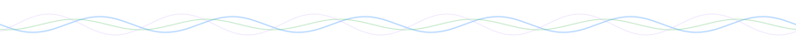

## right now

| | |
|---|---|
| building | [fred](https://github.com/guylyons/fred), a vim/ed text editor in Rust, for quick edits |
| polishing | [unpack](https://github.com/guylyons/unpack), drag-and-drop archive extraction for macOS |
| tinkering | [agent-smith](https://github.com/guylyons/agent-smith), a fun and productive UI for Claude agents |

## selected work

| project | what it is | stack |
|---|---|---|
| **[fred](https://github.com/guylyons/fred)** | a vim/ed text editor for quick edits | Rust |
| **[unpack](https://github.com/guylyons/unpack)** | drag-and-drop archive extractor for macOS, with Liquid Glass | Swift, SwiftUI |
| **[elmers](https://github.com/guylyons/elmers-app)** | everything you copy, one keystroke away. a free, clean-room clone of Paste for macOS | macOS |
| **[pss](https://github.com/guylyons/pss)** | readable `ps` for macOS | Rust |
| **[jj-emacs](https://github.com/guylyons/jj-emacs)** | a jj take on Magit for Emacs | Emacs Lisp |

## also shipped

| | |
|---|---|
| [mug](https://github.com/guylyons/mug) | keep your Mac awake |
| [half-life-macos-arm](https://github.com/guylyons/half-life-macos-arm) | native Apple Silicon build of Half-Life on Xash3D-FWGS, reading game data from your Steam install |
| [overflow-detective](https://github.com/guylyons/overflow-detective) | Chrome extension for finding and fixing hard-to-find overflow bugs |
| [Drupal-Migrate-Linter](https://github.com/guylyons/Drupal-Migrate-Linter) | a Drupal module for linting migrations |
| [express-preact](https://github.com/guylyons/express-preact) | Express + Preact starter |

## toolchain

**languages** Rust, Swift, TypeScript, PHP, Go, Emacs Lisp
**native mac** SwiftUI, AppKit
**web** Drupal, Node.js, Preact, React
**editors** Emacs, Neovim

## elsewhere

[guylyons.dev](https://guylyons.dev) · [dotfiles](https://github.com/guylyons/guy-chezmoi) · [neovim config](https://github.com/guylyons/neovim-config)

